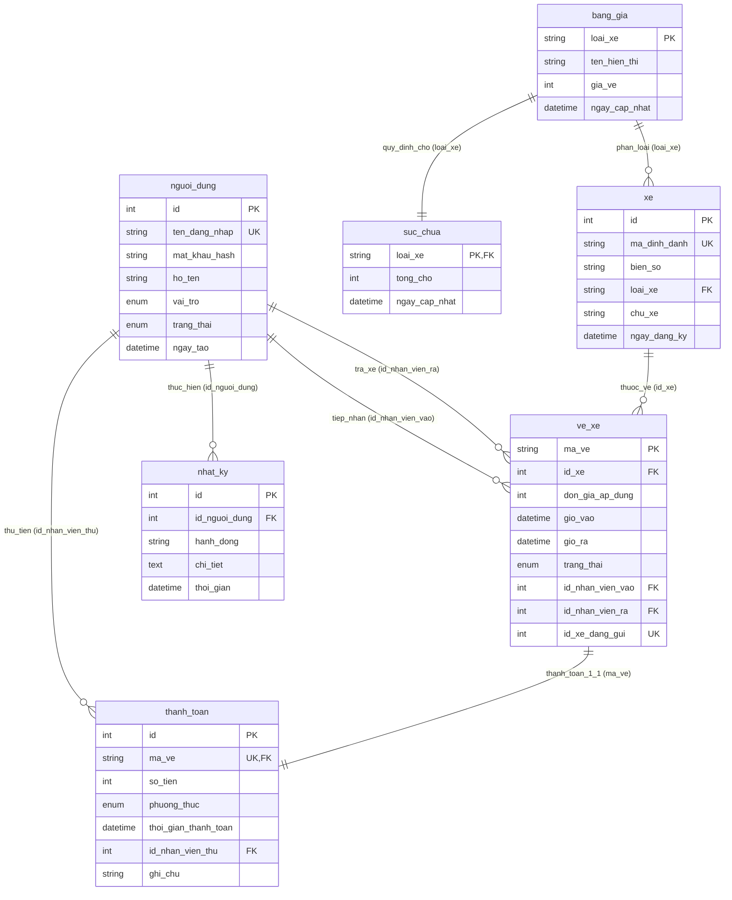

# THIẾT KẾ CƠ SỞ DỮ LIỆU MYSQL (DATABASE_DESIGN)

> **Cơ sở dữ liệu**: `neon_parking_db`  
> **Hệ quản trị CSDL**: MySQL Server 8.x / 9.x (Đã tối ưu hóa cho MySQL 9.7.1)  
> **Bảng mã & Đối chiếu**: `utf8mb4` – `utf8mb4_unicode_ci` (Hỗ trợ tiếng Việt có dấu hoàn hảo)  
> **Tệp kịch bản DDL**: `database/schema.sql`

---

## 1. TỔNG QUAN LƯỢC ĐỒ DỮ LIỆU (DATABASE SCHEMA OVERVIEW)

Hệ thống cơ sở dữ liệu được thiết kế đạt chuẩn hóa **Dạng chuẩn 3 (3NF)**, bao gồm **7 bảng quan hệ**, **8 khóa ngoại (Foreign Keys)**, các ràng buộc toàn vẹn dữ liệu nghiêm ngặt (`CHECK`, `UNIQUE`, `DEFAULT`, `GENERATED ALWAYS AS`) và các chỉ mục (`INDEX`) tối ưu hóa truy vấn tốc độ cao.



---

## 2. PHÂN TÍCH CHI TIẾT 7 BẢNG DỮ LIỆU

### 2.1. Bảng 1: `nguoi_dung` (Quản lý Tài khoản & Phân quyền)
- **Vai trò**: Quản lý thông tin đăng nhập, bảo mật và vai trò của nhân viên trực ca và quản trị viên.
- **Cấu trúc trường dữ liệu**:

| Tên cột | Kiểu dữ liệu | Ràng buộc | Ý nghĩa nghiệp vụ |
| :--- | :--- | :--- | :--- |
| `id` | `INT` | `AUTO_INCREMENT`, `PRIMARY KEY` | Định danh người dùng duy nhất |
| `ten_dang_nhap` | `VARCHAR(50)` | `NOT NULL`, `UNIQUE` | Tài khoản đăng nhập (không khoảng trắng, $\ge 3$ ký tự) |
| `mat_khau_hash` | `VARCHAR(255)` | `NOT NULL` | Chuỗi mã băm bảo mật Argon2id |
| `ho_ten` | `VARCHAR(100)` | `NOT NULL` | Họ tên đầy đủ của nhân viên |
| `vai_tro` | `ENUM('ADMIN', 'NHAN_VIEN')` | `NOT NULL`, `DEFAULT 'NHAN_VIEN'` | Vai trò phân quyền trong hệ thống |
| `trang_thai` | `ENUM('HOAT_DONG', 'KHOA')` | `NOT NULL`, `DEFAULT 'HOAT_DONG'` | Trạng thái hoạt động tài khoản |
| `ngay_tao` | `DATETIME` | `NOT NULL`, `DEFAULT CURRENT_TIMESTAMP` | Thời điểm tạo tài khoản |

- **Chỉ mục**: `idx_nguoi_dung_vai_tro (vai_tro)`, `idx_nguoi_dung_trang_thai (trang_thai)`.
- **Điểm an toàn đặc thù**: Không chèn tài khoản Admin với mật khẩu mặc định qua SQL. Ứng dụng áp dụng quy trình "First Admin Setup" khởi tạo Admin linh hoạt ngay trong lần chạy đầu tiên.

---

### 2.2. Bảng 2: `bang_gia` (Biểu Phí Gửi Xe)
- **Vai trò**: Lưu trữ danh mục đơn giá gửi xe áp dụng cho từng chủng loại phương tiện.
- **Cấu trúc trường dữ liệu**:

| Tên cột | Kiểu dữ liệu | Ràng buộc | Ý nghĩa nghiệp vụ |
| :--- | :--- | :--- | :--- |
| `loai_xe` | `VARCHAR(20)` | `PRIMARY KEY` | Mã loại xe: `'XeDap'`, `'XeMay'`, `'OTo'` |
| `ten_hien_thi` | `VARCHAR(50)` | `NOT NULL` | Tên tiếng Việt hiển thị trên giao diện |
| `gia_ve` | `INT` | `NOT NULL`, `CHECK (gia_ve >= 0)` | Đơn giá gửi xe tính bằng VNĐ (chặn số âm) |
| `ngay_cap_nhat` | `DATETIME` | `NOT NULL`, `DEFAULT CURRENT_TIMESTAMP ON UPDATE CURRENT_TIMESTAMP` | Thời điểm cập nhật giá vé gần nhất |

- **Dữ liệu khởi tạo chuẩn**:
  - `XeDap`: 2.000 VNĐ.
  - `XeMay`: 5.000 VNĐ.
  - `OTo`: 20.000 VNĐ.

---

### 2.3. Bảng 3: `suc_chua` (Quy Định Chỗ Đỗ)
- **Vai trò**: Quản lý tổng số chỗ đỗ tối đa cho từng loại xe trong khuôn viên bãi đỗ.
- **Cấu trúc trường dữ liệu**:

| Tên cột | Kiểu dữ liệu | Ràng buộc | Ý nghĩa nghiệp vụ |
| :--- | :--- | :--- | :--- |
| `loai_xe` | `VARCHAR(20)` | `PRIMARY KEY`, `FK -> bang_gia(loai_xe)` | Mã loại xe đồng bộ với bảng giá |
| `tong_cho` | `INT` | `NOT NULL`, `CHECK (tong_cho >= 0)` | Tổng số chỗ đỗ tối đa quy định |
| `ngay_cap_nhat` | `DATETIME` | `NOT NULL`, `DEFAULT CURRENT_TIMESTAMP ON UPDATE CURRENT_TIMESTAMP` | Thời điểm cập nhật sức chứa |

- **Khóa ngoại**: `CONSTRAINT fk_suc_chua_bang_gia FOREIGN KEY (loai_xe) REFERENCES bang_gia (loai_xe) ON UPDATE CASCADE ON DELETE RESTRICT`.
- **Dữ liệu khởi tạo chuẩn**:
  - `XeDap`: 50 chỗ.
  - `XeMay`: 150 chỗ.
  - `OTo`: 30 chỗ.

---

### 2.4. Bảng 4: `xe` (Danh Mục Phương Tiện)
- **Vai trò**: Quản lý hồ sơ định danh phương tiện và thông tin chủ sở hữu.
- **Cấu trúc trường dữ liệu**:

| Tên cột | Kiểu dữ liệu | Ràng buộc | Ý nghĩa nghiệp vụ |
| :--- | :--- | :--- | :--- |
| `id` | `INT` | `AUTO_INCREMENT`, `PRIMARY KEY` | ID phương tiện duy nhất trong hệ thống |
| `ma_dinh_danh` | `VARCHAR(50)` | `NOT NULL`, `UNIQUE` | Biển số xe máy/ô tô hoặc mã thẻ xe đạp riêng |
| `bien_so` | `VARCHAR(30)` | `NULL` | Biển số xe thực tế (cho phép NULL với Xe đạp) |
| `loai_xe` | `VARCHAR(20)` | `NOT NULL`, `FK -> bang_gia(loai_xe)` | Loại xe |
| `chu_xe` | `VARCHAR(100)` | `NOT NULL` | Họ tên hoặc thông tin chủ xe |
| `ngay_dang_ky` | `DATETIME` | `NOT NULL`, `DEFAULT CURRENT_TIMESTAMP` | Thời điểm lần đầu vào bãi |

- **Khóa ngoại**: `CONSTRAINT fk_xe_loai_xe FOREIGN KEY (loai_xe) REFERENCES bang_gia (loai_xe) ON UPDATE CASCADE ON DELETE RESTRICT`.
- **Chỉ mục**: `idx_xe_bien_so (bien_so)`, `idx_xe_loai_xe (loai_xe)`.

---

### 2.5. Bảng 5: `ve_xe` (Lượt Vào / Ra Của Phương Tiện)
- **Vai trò**: Quản lý lượt gửi xe, thời gian vào/ra, trạng thái và bảo toàn đơn giá kế toán.
- **Cấu trúc trường dữ liệu**:

| Tên cột | Kiểu dữ liệu | Ràng buộc | Ý nghĩa nghiệp vụ |
| :--- | :--- | :--- | :--- |
| `ma_ve` | `VARCHAR(20)` | `PRIMARY KEY` | Mã vé duy nhất (Ví dụ: `V-20261026-001`) |
| `id_xe` | `INT` | `NOT NULL`, `FK -> xe(id)` | Khóa ngoại trỏ về phương tiện tương ứng |
| `don_gia_ap_dung` | `INT` | `NOT NULL`, `CHECK (don_gia_ap_dung >= 0)` | **Snapshot đơn giá** tại thời điểm tiếp nhận xe |
| `gio_vao` | `DATETIME` | `NOT NULL`, `DEFAULT CURRENT_TIMESTAMP` | Thời điểm xe vào bãi |
| `gio_ra` | `DATETIME` | `NULL` | Thời điểm xe rời bãi |
| `trang_thai` | `ENUM('Dang gui', 'Da thanh toan', 'Da huy')` | `NOT NULL`, `DEFAULT 'Dang gui'` | Trạng thái của vé xe |
| `id_nhan_vien_vao` | `INT` | `NULL`, `FK -> nguoi_dung(id)` | Nhân viên thực hiện tiếp nhận |
| `id_nhan_vien_ra` | `INT` | `NULL`, `FK -> nguoi_dung(id)` | Nhân viên phụ trách cho xe ra |
| `id_xe_dang_gui` | `INT` | **`GENERATED ALWAYS AS`**, **`UNIQUE`** | Cột ảo chống 1 xe có 2 vé gửi đồng thời |

- **Cột ảo Virtual Generated Column đặc biệt**:
  ```sql
  id_xe_dang_gui INT GENERATED ALWAYS AS (
      CASE WHEN trang_thai = 'Dang gui' THEN id_xe ELSE NULL END
  ) VIRTUAL,
  CONSTRAINT uq_xe_dang_gui UNIQUE (id_xe_dang_gui)
  ```
  *Ý nghĩa*: Khi xe đang ở trạng thái `'Dang gui'`, cột `id_xe_dang_gui` nhận giá trị `id_xe`. Vì có ràng buộc `UNIQUE`, MySQL sẽ lập tức từ chối bất kỳ thao tác tạo vé mới nào cho chiếc xe đó nếu vé trước chưa thanh toán. Khi xe đã thanh toán (`'Da thanh toan'`), cột nhận giá trị `NULL` (MySQL cho phép nhiều giá trị NULL trong cột UNIQUE), xe có thể vào bãi ở lượt tiếp theo bình thường.

---

### 2.6. Bảng 6: `thanh_toan` (Giao Dịch Doanh Thu)
- **Vai trò**: Quản lý các giao dịch tài chính thu tiền từ vé xe, bảo đảm nguyên tắc kế toán không bị thanh toán trùng.
- **Cấu trúc trường dữ liệu**:

| Tên cột | Kiểu dữ liệu | Ràng buộc | Ý nghĩa nghiệp vụ |
| :--- | :--- | :--- | :--- |
| `id` | `INT` | `AUTO_INCREMENT`, `PRIMARY KEY` | Mã giao dịch tự tăng |
| `ma_ve` | `VARCHAR(20)` | `NOT NULL`, **`UNIQUE`**, `FK -> ve_xe(ma_ve)` | Mã vé xe thanh toán (Quan hệ 1-1 với `ve_xe`) |
| `so_tien` | `INT` | `NOT NULL`, `CHECK (so_tien >= 0)` | Số tiền thực thu (VNĐ) |
| `phuong_thuc` | `ENUM('TIEN_MAT', 'CHUYEN_KHOAN')` | `NOT NULL`, `DEFAULT 'TIEN_MAT'` | Kênh thanh toán: Tiền mặt hoặc Ngân hàng |
| `thoi_gian_thanh_toan` | `DATETIME` | `NOT NULL`, `DEFAULT CURRENT_TIMESTAMP` | Thời điểm thu tiền |
| `id_nhan_vien_thu` | `INT` | `NULL`, `FK -> nguoi_dung(id)` | Nhân viên trực ca thực hiện thu tiền |
| `ghi_chu` | `VARCHAR(255)` | `NULL` | Ghi chú giao dịch (nếu có) |

- **Khóa ngoại**:
  - `CONSTRAINT fk_thanh_toan_ve FOREIGN KEY (ma_ve) REFERENCES ve_xe (ma_ve) ON UPDATE CASCADE ON DELETE RESTRICT`.
  - `CONSTRAINT fk_thanh_toan_nv FOREIGN KEY (id_nhan_vien_thu) REFERENCES nguoi_dung (id) ON DELETE SET NULL`.
- **Ràng buộc quan trọng**: Cột `ma_ve` được định nghĩa `UNIQUE`, ngăn chặn hoàn toàn việc thu ngân bấm thanh toán 2 lần cho cùng một mã vé.

---

### 2.7. Bảng 7: `nhat_ky` (Nhật Ký Kiểm Toán - Audit Trail)
- **Vai trò**: Lưu trữ toàn bộ lịch sử các thao tác quan trọng trong hệ thống phục vụ công tác thanh tra và kiểm soát rủi ro.
- **Cấu trúc trường dữ liệu**:

| Tên cột | Kiểu dữ liệu | Ràng buộc | Ý nghĩa nghiệp vụ |
| :--- | :--- | :--- | :--- |
| `id` | `INT` | `AUTO_INCREMENT`, `PRIMARY KEY` | Mã bản ghi sự kiện |
| `id_nguoi_dung` | `INT` | `NULL`, `FK -> nguoi_dung(id)` | Người thực hiện thao tác |
| `hanh_dong` | `VARCHAR(100)` | `NOT NULL` | Mã hành động (`DANG_NHAP`, `TIEP_NHAN_XE`...) |
| `chi_tiet` | `TEXT` | `NULL` | Chi tiết nội dung thao tác |
| `thoi_gian` | `DATETIME` | `NOT NULL`, `DEFAULT CURRENT_TIMESTAMP` | Thời điểm phát sinh sự kiện |

- **Khóa ngoại**: `CONSTRAINT fk_nhat_ky_nguoi_dung FOREIGN KEY (id_nguoi_dung) REFERENCES nguoi_dung (id) ON DELETE SET NULL`.
- **Chỉ mục**: `idx_nhat_ky_thoi_gian (thoi_gian)`, `idx_nhat_ky_hanh_dong (hanh_dong)`.

---

## 3. NGUYÊN TẮC THIẾT KẾ & TÍNH TOÀN VẸN DỮ LIỆU

1. **Chuẩn hóa 3NF**: Tách bạch thông tin phương tiện (`xe`) khỏi lượt gửi (`ve_xe`) và giao dịch (`thanh_toan`). Không trùng lặp thông tin biển số, chủ xe qua nhiều bảng.
2. **Snapshot Đơn giá Kế toán**: Cột `don_gia_ap_dung` tại `ve_xe` chụp lại giá vé tại thời điểm nhận xe. Nếu ngày mai Admin tăng giá vé xe máy từ 5.000đ lên 10.000đ, những xe đang gửi từ hôm nay khi ra bãi vẫn tính đúng 5.000đ.
3. **Toàn vẹn tham chiếu (Referential Integrity)**: Sử dụng các hành vi `ON UPDATE CASCADE` (khi đổi mã khóa) và `ON DELETE RESTRICT` (ngăn xóa bảng cha khi còn dữ liệu con), bảo vệ cơ sở dữ liệu không bị mồ côi bản ghi.
4. **An toàn Giao dịch (ACID)**: Khi thanh toán, 2 thao tác cập nhật `ve_xe` và thêm `thanh_toan` bắt buộc được bao bọc trong một MySQL Transaction với cơ chế tự động Rollback khi có sự cố.
