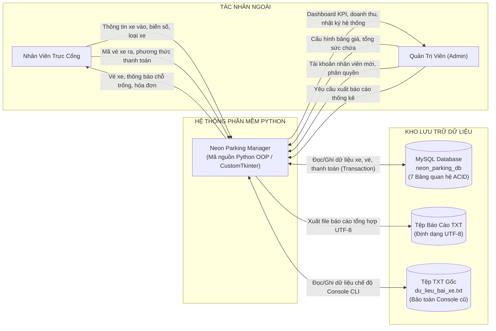
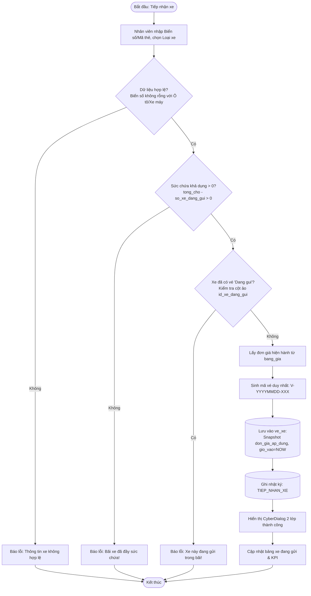
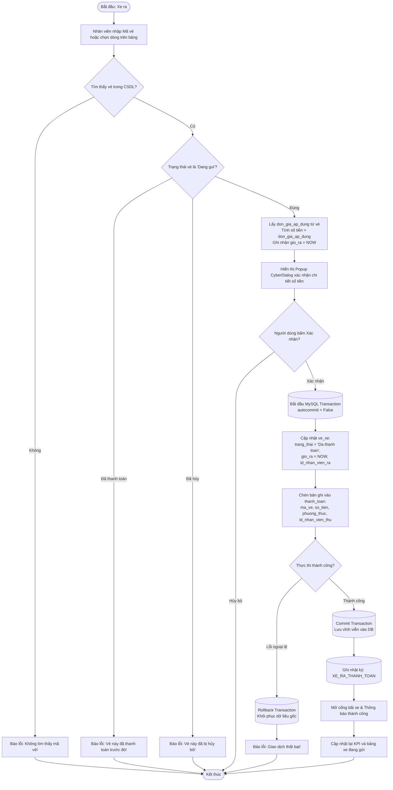
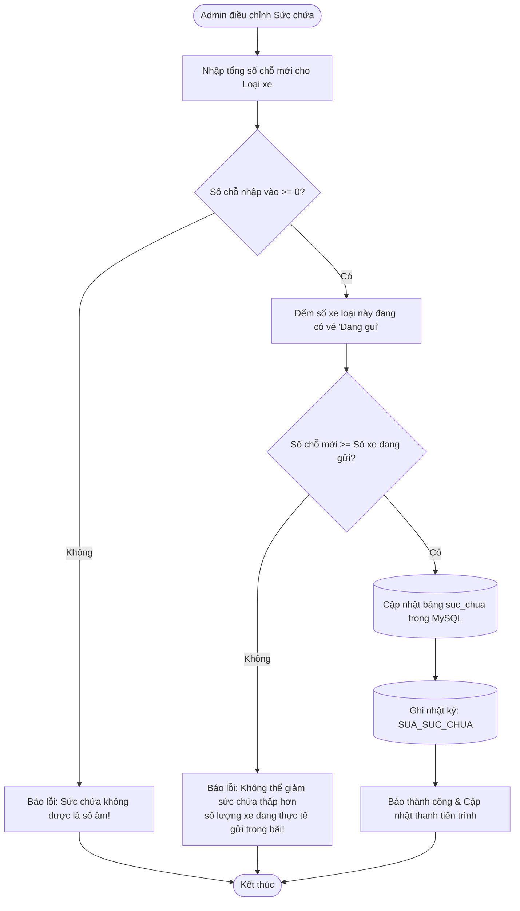
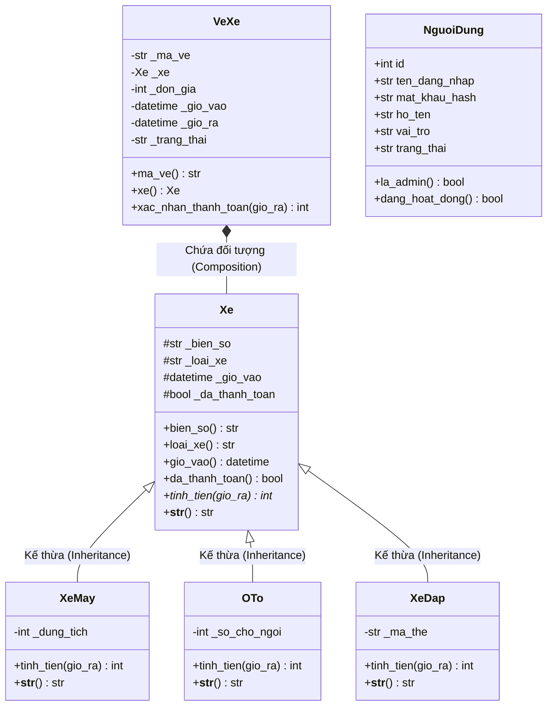
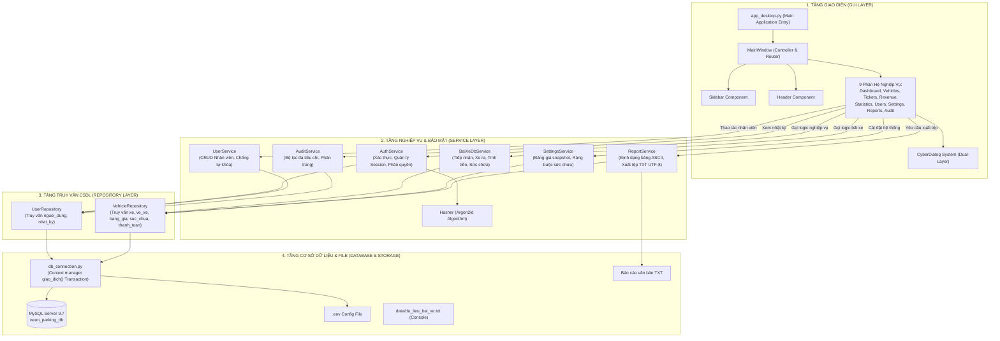

# TỔNG HỢP SƠ ĐỒ VÀ BẢN VẼ HỆ THỐNG (DIAGRAM_PLAN)

> **Mục đích**: Cung cấp toàn bộ các sơ đồ luồng dữ liệu, sơ đồ kiến trúc, lưu đồ thuật toán và sơ đồ lớp hướng đối tượng theo đúng yêu cầu bắt buộc của file PDF mẫu học phần (`BaoCao_LapTrinhPython_Maubaocao.pdf`).  
> **Nguyên tắc**: 100% sơ đồ được xây dựng dựa trên quy trình nghiệp vụ và cấu trúc mã nguồn có thật trong dự án Neon Parking Manager.

---

## 1. SƠ ĐỒ DFD CẤP 0 (DATA FLOW DIAGRAM LEVEL 0)

*Căn cứ*: Phần Giới thiệu trong PDF mẫu yêu cầu mô tả luồng dữ liệu đi từ người dùng vào script Python và lưu xuống kho dữ liệu.
*Lưu ý dự án*: MySQL Server là nơi lưu trữ dữ liệu chính (Operational Database), file TXT là dữ liệu xuất báo cáo định kỳ.

---

## 2. SƠ ĐỒ PHÂN CẤP CHỨC NĂNG (FUNCTION DECOMPOSITION DIAGRAM)

*Căn cứ*: Chương 2 – Thiết kế kiến trúc theo yêu cầu PDF mẫu.

```mermaid
graph TD
    ROOT["HỆ THỐNG NEON PARKING MANAGER"]

    ROOT --> M1["1. XÁC THỰC & BẢO MẬT"]
    M1 --> M1_1["Thiết lập Admin đầu tiên"]
    M1 --> M1_2["Đăng nhập (Argon2id)"]
    M1 --> M1_3["Đổi mật khẩu cá nhân"]
    M1 --> M1_4["Đăng xuất & Hủy phiên"]

    ROOT --> M2["2. TIẾP NHẬN PHƯƠNG TIỆN"]
    M2 --> M2_1["Kiểm tra sức chứa khả dụng"]
    M2 --> M2_2["Chặn xe đang gửi trùng lặp"]
    M2 --> M2_3["Chụp snapshot đơn giá"]
    M2 --> M2_4["Cấp mã vé và in thẻ"]

    ROOT --> M3["3. XỬ LÝ XE RA & THANH TOÁN"]
    M3 --> M3_1["Tra cứu vé (Biển số / Mã vé)"]
    M3 --> M3_2["Tính toán thời gian & số tiền"]
    M3 --> M3_3["Thanh toán Tiền mặt / Ngân hàng"]
    M3 --> M3_4["Thực thi MySQL Transaction"]

    ROOT --> M4["4. QUẢN TRỊ & THỐNG KÊ (Admin)"]
    M4 --> M4_1["Dashboard KPI thời gian thực"]
    M4 --> M4_2["Thống kê doanh thu & Giờ cao điểm"]
    M4 --> M4_3["Quản lý nhân viên (Chống tự khóa)"]
    M4 --> M4_4["Cài đặt bảng giá & Sức chứa"]
    M4 --> M4_5["Xuất báo cáo văn bản TXT"]
    M4 --> M4_6["Truy vấn nhật ký kiểm toán (Audit)"]
```

---

## 3. LƯU ĐỒ THUẬT TOÁN (FLOWCHARTS) CÁC CHỨC NĂNG CỐT LÕI

### 3.1. Lưu đồ tiếp nhận xe vào bãi (Check-in Flowchart)
Mô tả quy trình xử lý nghiệp vụ khi một phương tiện đến cổng bãi đỗ:

---

### 3.2. Lưu đồ xe ra và xử lý thanh toán (Check-out Flowchart)
Mô tả nghiệp vụ khi xe rời bãi, áp dụng MySQL Transaction bảo toàn kế toán:

---

### 3.3. Lưu đồ điều chỉnh cấu hình sức chứa an toàn (Capacity Settings Flowchart)
Minh chứng việc bảo vệ toàn vẹn nghiệp vụ (không thể giảm sức chứa dưới số xe đang đỗ):

---

## 4. SƠ ĐỒ LỚP HƯỚNG ĐỐI TƯỢNG (OOP CLASS DIAGRAM)

*Căn cứ*: Chương 2 & 3 – Thể hiện nguyên lý Kế thừa, Đóng gói và Đa hình trong `models/`:

---

## 5. SƠ ĐỒ KIẾN TRÚC PHÂN TẦNG (TIER ARCHITECTURE DIAGRAM)

